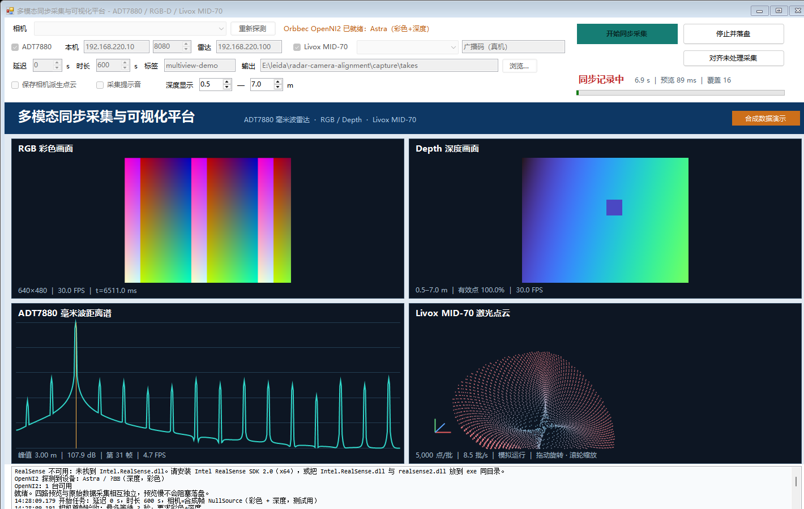
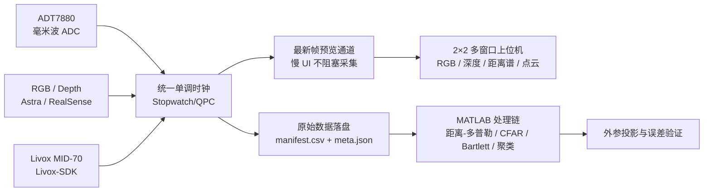
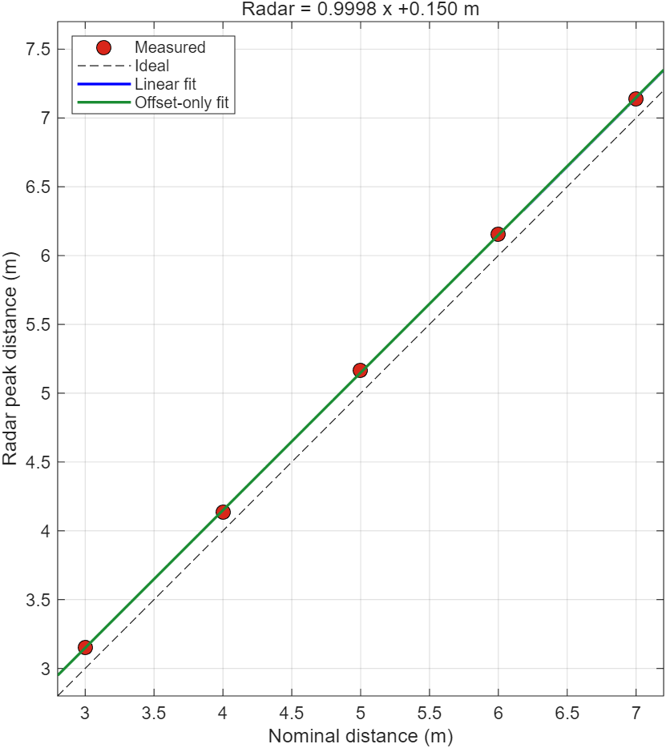
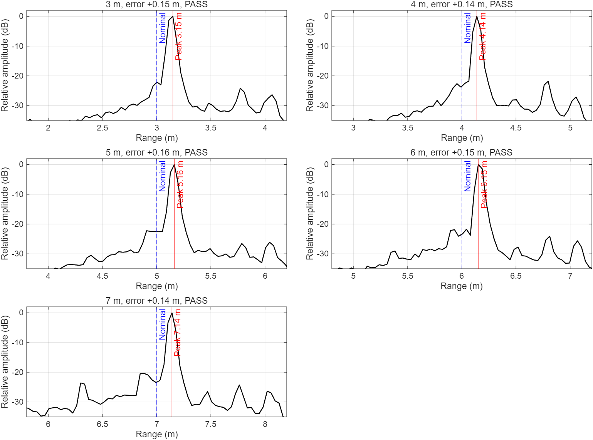
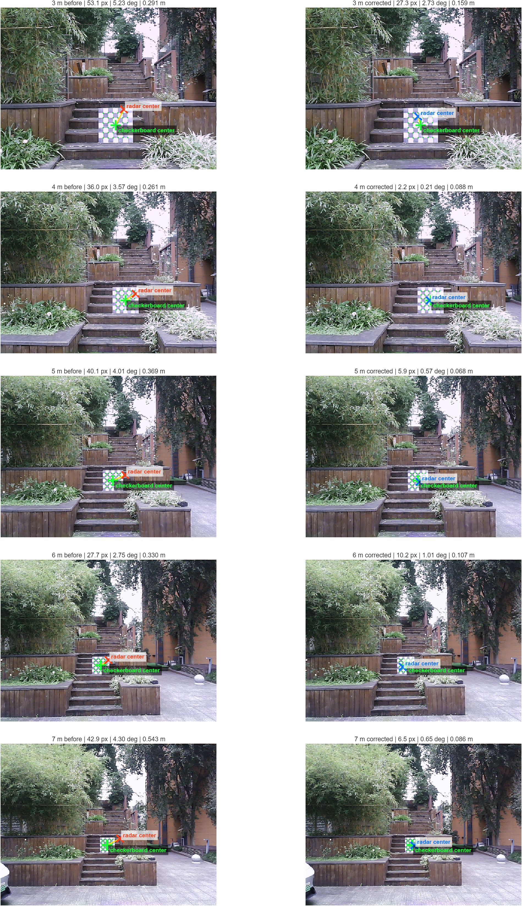

# 多模态同步采集、标定与可视化融合系统

面向室内验证、普通室外 3–7 m 和后续矿山感知场景，构建 **ADT7880 毫米波雷达 + RGB/深度相机 + Livox MID-70 激光雷达** 的多源数据采集与处理平台。系统覆盖统一时间基准采集、设备健康监控、时空标定、雷达信号处理、点云生成、四窗口实时可视化和可复现验证。

**项目成员：余佳欣、苟怡菲、闫傲雪**

> 当前首版完成四路独立显示与同步采集，尚不宣称已经完成跨传感器实时融合叠加。MID-70 真机接口已提供桥接源码，因当前无设备和 C++ 构建环境，真机连接、PTP/PPS 和断流恢复仍需硬件到位后验收。



上图由程序的合成相机、真实 UDP 回环毫米波数据和 MID-70 合成点云实际运行生成；雷达距离谱中的合成主目标位于 `3.00 m`。合成模式用于无硬件开发和回归，不作为真机性能结果。

## 系统架构



## 核心能力

| 子系统 | 当前能力 |
|---|---|
| 同步采集 | RGB、深度、毫米波雷达和 LiDAR 共用相对时间轴；`manifest.csv` 记录每帧/批次文件和时间戳 |
| 采集可靠性 | 固定网卡地址检查、串口自动枚举、UDP 回包确认、首次无包重发、断流自动 Pause/Start 与串口切换 |
| 相机链路 | 首帧验收、彩色 PNG、16-bit 深度 PNG、可选相机点云、内参与深度单位记录 |
| 毫米波处理 | ADC 收包与丢包统计、MAT 落盘、1024 点 Hamming 距离 FFT 实时预览、MATLAB 距离/多普勒/CFAR/近场 Bartlett/聚类 |
| 激光雷达 | `ILidarSource` 抽象、合成/回放/MID-70 原生桥接源、版本化点云批次、交互式点云旋转缩放 |
| 工程验证 | 无硬件四路自测、UDP 回环、take 结构校验、FFT 已知峰值、点云回读、UI 冒烟 |

## 本周成果（2026-11-09—2026-11-13）

### 1. 基于原采集程序完成可靠性优化

- 自动检查本机雷达网卡地址，避免跨电脑部署时静默收不到数据。
- 自动枚举串口，以收到真实 UDP ADC 包作为雷达启动成功的唯一判断。
- 首次无包自动重发 Start；采集中断流自动 Pause/Start、重开或切换串口。
- 增加相机首帧验收、进入记录后的落盘验收、GUI 健康状态和恢复次数。
- 相机 PNG 编码与取帧解耦；写盘跟不上时只统计并丢弃待写帧，不拖慢设备取帧。

### 2. 完成四窗口可视化同步采集上位机

- 单窗口 `2×2` 同步展示 RGB、深度伪彩、ADT7880 距离谱和 MID-70 点云。
- 深度显示范围可调，实时显示有效深度点比例。
- 毫米波按完整帧抽样执行距离 FFT，并显示最强峰值距离和强度。
- 点云支持鼠标拖动旋转与滚轮缩放，显示批次率、点数和设备状态。
- 预览采用“最新帧覆盖”缓冲；UI 落后只覆盖旧预览，不影响原始数据落盘。
- 新增 MID-70 合成、二进制回放与 Livox-SDK 原生桥接接口。

### 3. 完成时空标定与室外数据分析

- 正式机械外参留出板心误差由 `0.473 m` 降至 `0.150 m`。
- 室外 3–7 m 距离关系拟合为 `Radar ≈ 0.9998 × nominal + 0.150 m`，表现为固定偏差而非比例误差。
- 五组实验拟合集的三维平均误差约由 `0.359 m` 降至 `0.102 m`，降低约 `71.7%`。
- 留一验证为 5 组中 4 组达到 `0.15 m` 门限，3 m 组约 `0.16 m`；因此候选距离/方位/俯仰补偿仍为实验结论，稳定处理链默认不启用。

| 验证项 | 结果 |
|---|---:|
| 正式外参留出误差 | `0.473 → 0.150 m` |
| 五组距离谱峰值偏差 | 约 `0.14–0.16 m` |
| 实验拟合集平均误差 | `0.359 → 0.102 m` |
| 留一验证 | `4 / 5` 通过，3 m 约 `0.16 m` |
| 四路合成自测 | RGB、Depth、Radar、LiDAR 全部通过 |

| 距离拟合 | 五组距离谱 |
|---|---|
|  |  |



## 深度相机与场景路线

结合普通室外、多云、3–7 m 以及后续露天矿场景的选型分析：

- **Astra Pro**：保留作室内和短距离对照，不作为室外 3–7 m 主传感器。
- **普通室外 3–7 m**：优先验证被动双目 `Stereolabs ZED 2i`。
- **车载、露天矿和长期工业部署**：采用 `ZED X` 级工业双目与 LiDAR 融合，补充防护、减振、镜头清洁和工业连接方案。
- **短距离工业避障**：可现场评估工业 ToF；高精度体积或结构测量应采用激光轮廓或地面激光扫描。

最终型号仍需在真实多云、逆光、粉尘和振动条件下完成 3/5/7 m A/B 测试。

## 数据产物

一次四路采集目录包括：

```text
take/
├─ radar_adc.mat             毫米波原始 ADC
├─ radar_frames.csv          雷达帧完整性和丢包统计
├─ color/*.png               RGB 帧
├─ depth/*.png               16-bit 深度帧
├─ lidar/*.bin               LIVOXBIN_V1 点云批次
├─ depth_scale.txt
├─ manifest.csv              四路统一时间轴
└─ meta.json                 设备、模式、内参、帧率、统计与告警
```

原始 ADC、彩色图、深度图、点云、MATLAB 结果和厂商 SDK 二进制不进入 Git 仓库。

## 快速运行

采集程序保持 `.NET Framework 4.0`、WinForms、x64 和系统 `csc.exe` 构建方式：

```powershell
cd E:\leida\radar-camera-alignment\capture\app
.\build.ps1
.\bin\Acquire.exe
```

无硬件四路全链路测试：

```powershell
.\bin\Acquire.exe --self-test --delay 0 --duration 3 --fps 2
```

重新生成 README 中的合成演示截图：

```powershell
.\bin\Acquire.exe --demo-screenshot ..\..\docs\images\multiview-dashboard.png
```

MATLAB 单组或批量处理：

```matlab
cd('E:\leida\radar-camera-alignment\matlab')
run_compute_interactive
```

更多采集格式与设备说明见 [capture/README.md](capture/README.md)，自动测试与 30 分钟压力测试结果见 [docs/multiview-validation.md](docs/multiview-validation.md)，MID-70 原生桥接见 [capture/native/LivoxBridge/README.md](capture/native/LivoxBridge/README.md)。

## 阶段指标与后续计划

以下是下一阶段目标，不作为当前已完成实测结果：

| 指标 | 阶段目标 |
|---|---:|
| 连续采集丢帧率 | `< 1%` |
| P95 预览延迟 | `≤ 2 个帧周期` |
| 稳定性测试 | 连续 `30 min` 无异常断流 |
| 数据一致性 | 四路文件、manifest 与 meta 完全一致 |
| 几何验证 | 独立数据三维板心误差 `≤ 0.15 m` |

下一步工作：接入 MID-70 真机，完成发现、连接、点格式与断流恢复验证；评估毫米波雷达与 LiDAR 独立网卡/网段；验证 PTPv2/PPS 时间同步；在真机数据基础上开展毫米波、激光点云与 RGB/深度的坐标统一和融合叠加。
