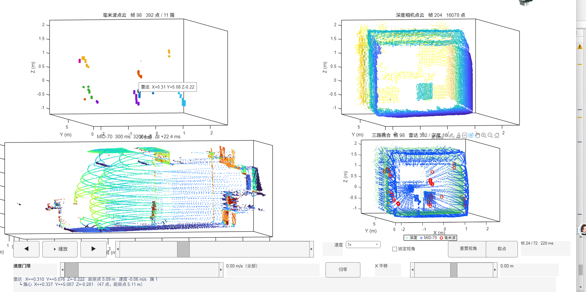
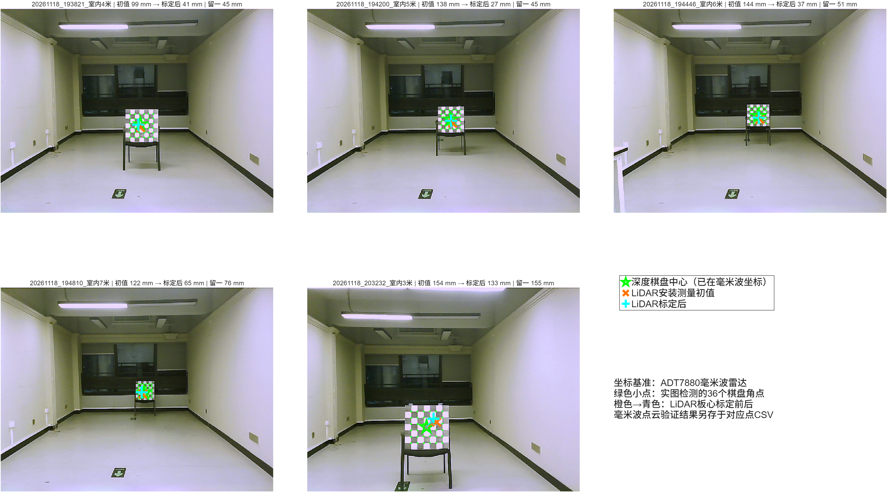
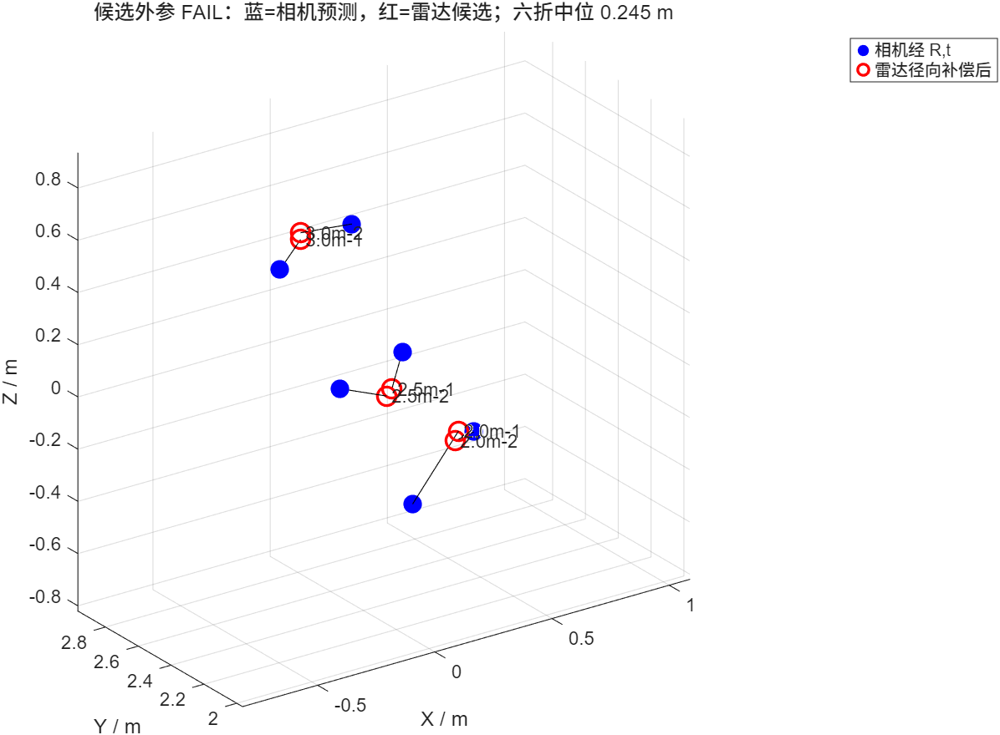
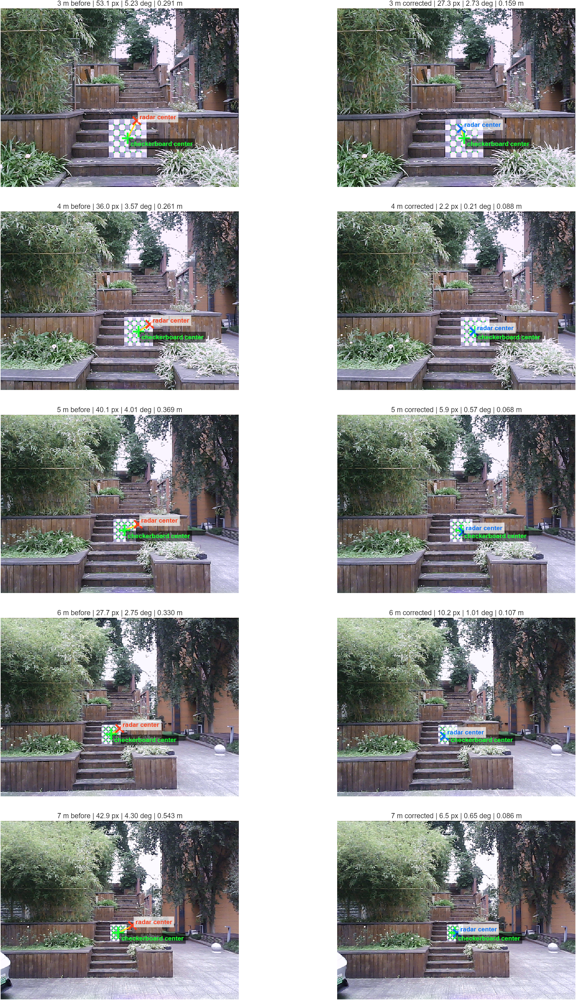
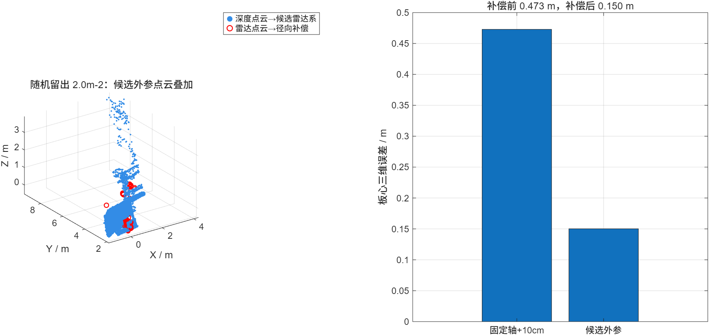
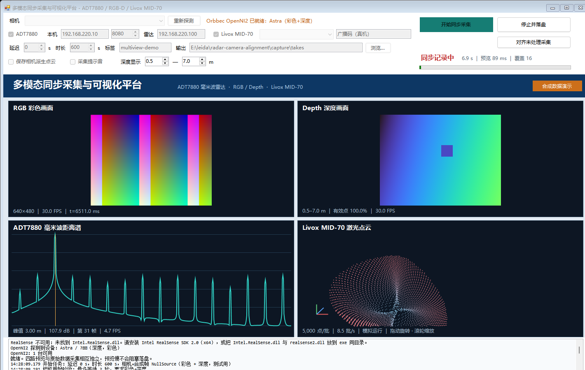

# 多模态感知信息实时融合系统

项目成员：余佳欣、苟怡菲、闫傲雪

面向室内验证、普通室外 3–7 m 与后续矿山感知场景，构建 **ADT7880 毫米波雷达 + 视觉相机 + Livox MID-70 激光雷达** 的多源同步采集、标定与融合平台。

---

## 一、项目目标

### 考核指标

| 项 | 目标 |
|---|---|
| 项目目标 | 多模态感知信息**实时融合**，交付一套实时多模态融合系统 |
| 硬件平台 | ADT7880 毫米波雷达 + 视觉相机 + Livox MID-70 激光雷达 |
| 丢帧率 | `< 1%` |
| P95 预览时延 | `≤ 2` 个帧周期 |
| 稳定性 | 连续 `30 min` 无异常断流 |
| 几何验证 | 独立数据三维板心误差 `≤ 0.15 m` |

### 技术路线

贯穿「理论 → 仿真 → 实现 → 工程化」：

1. **理论与算法**：FMCW 雷达原理、信号处理与融合
2. **仿真与算法验证**：MATLAB 处理链（距离–多普勒 / CFAR / 近场 Bartlett / 聚类）
3. **实时采集实现**：C# WinForms 四路同步采集上位机
4. **工程化训练**：时空同步与校准、无硬件自测、压力测试、代码工程化

### 场景与传感器路线

- **室内 / 短距对照**：Astra Pro 深度相机
- **普通室外 3–7 m**：优先验证被动双目 Stereolabs ZED 2i
- **车载 / 露天矿 / 长期工业部署**：ZED X 级工业双目 + LiDAR 融合

最终型号需在真实多云、逆光、粉尘、振动条件下完成 3 / 5 / 7 m A/B 测试。

---

## 二、目前进展

### 本次主线交付内容

1. **雷达–LiDAR 标定**：完成 ADT7880 与 Livox MID-70 的统一坐标框架、棋盘平面提取、平移标定和留一验证。候选外参与结果图已归档到 [docs/extrinsics/lidar-radar/](docs/extrinsics/lidar-radar/)，算法与复现说明见 [docs/lidar-radar-alignment.md](docs/lidar-radar-alignment.md) 及 `matlab/lidar/`。
2. **多模态采集程序**：提供 C# WinForms 采集上位机，统一记录雷达 ADC、RGB、深度和 MID-70 数据，包含设备预检、时间轴、丢包统计、回放与无硬件自测。入口见 [capture/README.md](capture/README.md)。
3. **离线点云融合**：MATLAB 处理雷达距离–多普勒、CFAR、近场 Bartlett、聚类，并将深度与 MID-70 统一变换到 ADT7880 坐标系。播放器和批处理入口见 [matlab/view_take.m](matlab/view_take.m)、[matlab/compute_all.m](matlab/compute_all.m)。



### 昨晚雷达–LiDAR 对齐结果

下面这张图是昨晚 3–7 m 五组棋盘数据生成的雷达坐标投影结果：橙色为 LiDAR 安装测量初值，青色为标定后的 LiDAR 板心，绿色为深度棋盘中心。



图中红色为毫米波点云，绿色为深度相机点云，蓝色为 MID-70 点云；融合显示仅使用已通过适用性检查的 LiDAR→雷达候选外参。

### 1. 实现毫米波雷达与相机的坐标对齐

已完成 ADT7880 毫米波雷达与相机的外参标定与坐标投影验证：正式外参留出板心误差由 `0.473 m` 降至 `0.150 m`，五组实验平均三维误差由 `0.359 m` 降至 `0.102 m`，留一验证 `4 / 5` 组达到 `0.15 m` 门限。







### 2. 改良采集程序，实现可视化 GUI

在原采集程序基础上完成可靠性改良与四窗口可视化上位机，单窗口 `2×2` 同步展示 RGB、深度伪彩、ADT7880 距离谱与点云，预览与原始数据落盘解耦，为后期**实时点云直接多模态重合**做铺垫。



### 测试状态

- **离线雷达–LiDAR 标定**：已使用 3–7 m 五组采集数据完成候选外参拟合与留一验证，结果已归档到 `docs/extrinsics/lidar-radar/`。
- **采集程序**：C# 程序可编译，并已通过无硬件合成链路的大部分自测；真实设备状态以现场连接和 `meta.json` 为准。
- **实时真机融合**：仍需在目标机器上确认 MID-70、ADT7880 和相机的实时连接、时间同步与断流恢复。

---

## 三、仓库结构

```text
signal-processing-multimodal-fusion/
├─ capture/                C# WinForms 同步采集程序（相机 / 雷达 / LiDAR / 深度 / 预览）
│  ├─ app/                 采集上位机源码与 build.ps1
│  ├─ docs/                采集说明、进度、固件改动、丢帧排查
│  └─ native/LivoxBridge/  MID-70 原生桥接（C++/CMake）
├─ matlab/                 信号处理链与外参标定 / 验证工具
│  ├─ algorithm/           距离 FFT / CFAR / 近场 Bartlett / 聚类
│  ├─ tools/               外参标定、候选求解、残差与板心验证
│  └─ verify_range_fft/    距离 FFT 验证 GUI
├─ docs/
│  ├─ extrinsics/          雷达–相机外参标定结果与坐标投影说明
│  ├─ experiments/2026-11-05/  室外 3–7 m 棋盘实验报告
│  └─ images/              文档配图
└─ README.md
take/
├─ radar_adc.mat             毫米波原始 ADC
├─ radar_frames.csv          雷达帧完整性和丢包统计
├─ color/*.png               RGB 帧
├─ depth/*.png               16-bit 深度帧
├─ lidar/*.bin               LIVOXBIN_V3 原始笛卡尔记录（兼容读取 V1/V2）
├─ lidar_frames.csv          LiDAR 批次时间与完整性统计
├─ depth_scale.txt
├─ manifest.csv              四路统一时间轴
└─ meta.json                 设备、模式、内参、帧率、统计与告警
```

---

## 四、快速运行

采集程序（.NET Framework 4.0 / WinForms / x64，系统 `csc.exe` 构建）：

```powershell
cd E:\leida\radar-camera-alignment\capture\app
.\build.ps1
.\bin\Acquire.exe
```

无硬件四路全链路测试：

```powershell
.\bin\Acquire.exe --self-test --delay 0 --duration 3 --fps 2
```

MATLAB 单组或批量处理：

```matlab
cd('E:\leida\radar-camera-alignment\matlab')
run_compute_interactive
```

MID-70 原始记录生成 PLY 点云：

```powershell
cd E:\leida\radar-camera-alignment\capture\app
.\export-lidar.ps1 -TakeDirectory "完整take目录" -Merged
```

空间对齐继续以 ADT7880 雷达坐标 `X右 / Y前 / Z上` 为统一坐标：相机使用已有 `camera→radar` 外参，MID-70 使用 `matlab/lidar` 中的 `lidar→radar` 框架。流程见 [docs/lidar-radar-alignment.md](docs/lidar-radar-alignment.md)。

更多采集格式与设备说明见 [capture/README.md](capture/README.md)，自动测试与 30 分钟压力测试结果见 [docs/multiview-validation.md](docs/multiview-validation.md)，MID-70 原生桥接见 [capture/native/LivoxBridge/README.md](capture/native/LivoxBridge/README.md)。

更多分支说明见 [docs/BRANCHES.md](docs/BRANCHES.md)，历史课设资料见 [docs/legacy-course-design/README.md](docs/legacy-course-design/README.md)。

在线操作手册：[三模态点云融合执行手册](https://guide.tulip.yu/docs/offline-fusion-workflow.html)

---

## 五、后续计划

1. 完成毫米波雷达、激光雷达真机测试。
2. 接入 MID-70 真机，验证 PTPv2 / PPS 时间同步与断流恢复。
3. 在真机数据基础上开展毫米波、激光点云与 RGB / 深度的坐标统一与**实时融合叠加**。
4. 实测收敛丢帧率 `< 1%`、P95 时延 `≤ 2` 帧周期与连续 `30 min` 稳定性，补齐考核指标。
