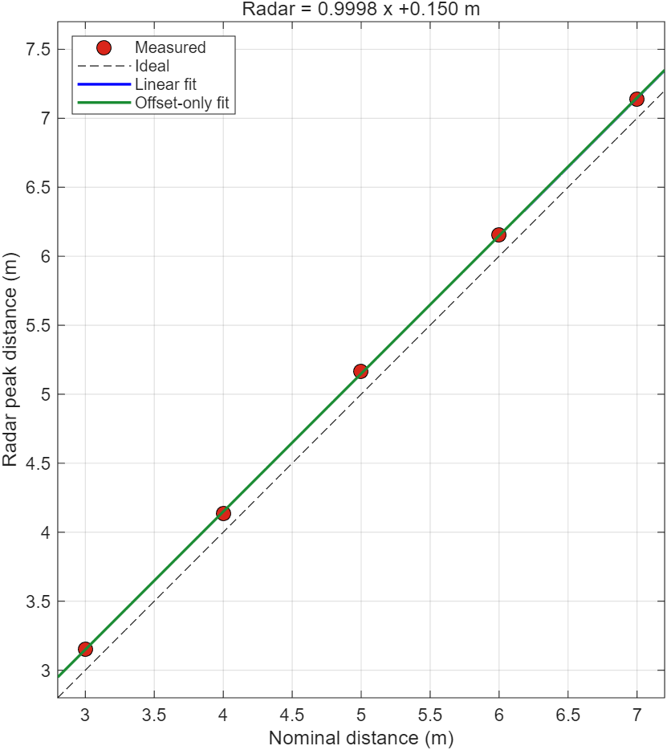
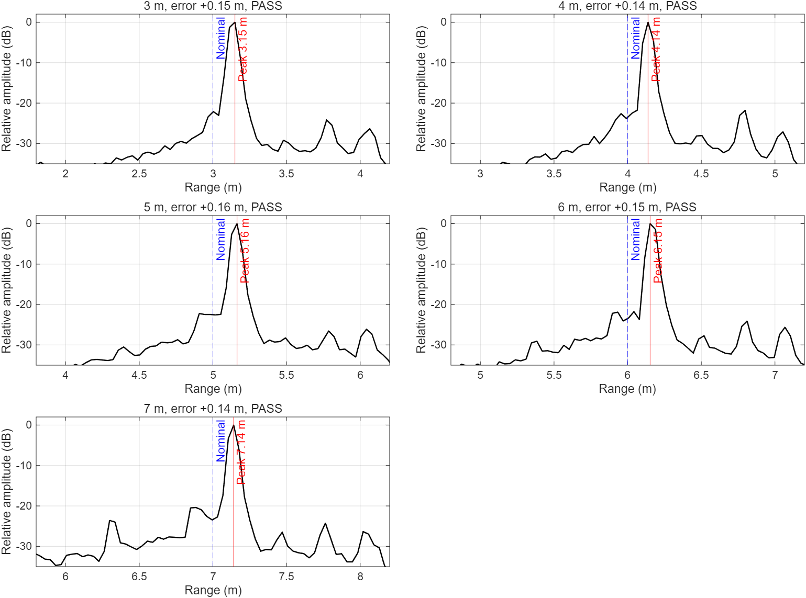
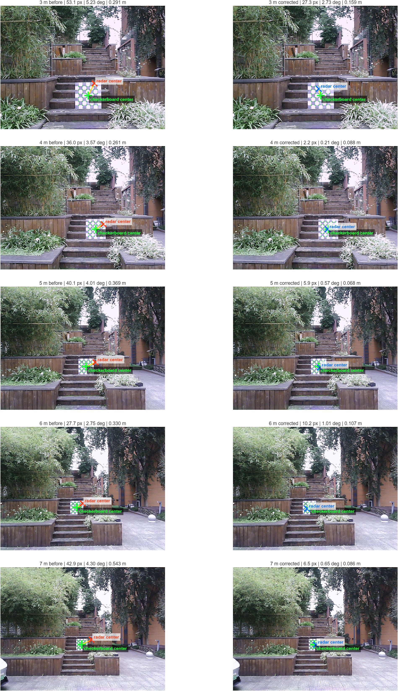

# 室外 3–7 m 雷达-相机对齐实验摘要

本目录只保存成果图和摘要数据，不包含原始 ADC、相机图像或默认启用的补偿参数。

五组棋盘目标的距离拟合为：

```text
Radar ≈ 0.999776 × nominal + 0.150149 m
```

候选三参数补偿在同组拟合集上把平均三维误差由约 `0.359 m` 降至 `0.102 m`，降低约 `71.7%`。留一验证中 4/5 组达到 `0.15 m` 门限，3 m 组约 `0.16 m`，因此该结果只能作为继续试验的依据，稳定处理链保持默认零补偿。

| 距离 | 补偿前三维误差 | 拟合集补偿后误差 | 留一验证误差 |
|---:|---:|---:|---:|
| 3 m | 0.315 m | 0.15 m | 0.16 m |
| 4 m | 0.287 m | 0.02 m | 0.02 m |
| 5 m | 0.389 m | 0.05 m | 0.06 m |
| 6 m | 0.328 m | 0.11 m | 0.14 m |
| 7 m | 0.547 m | 0.08 m | 0.12 m |






