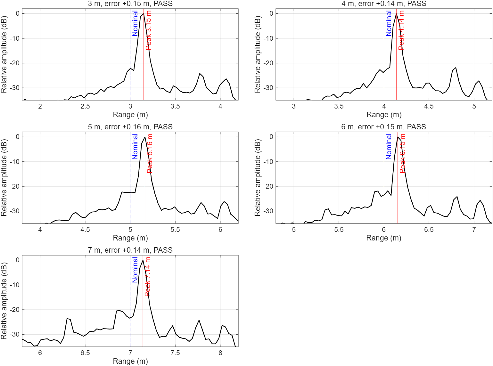
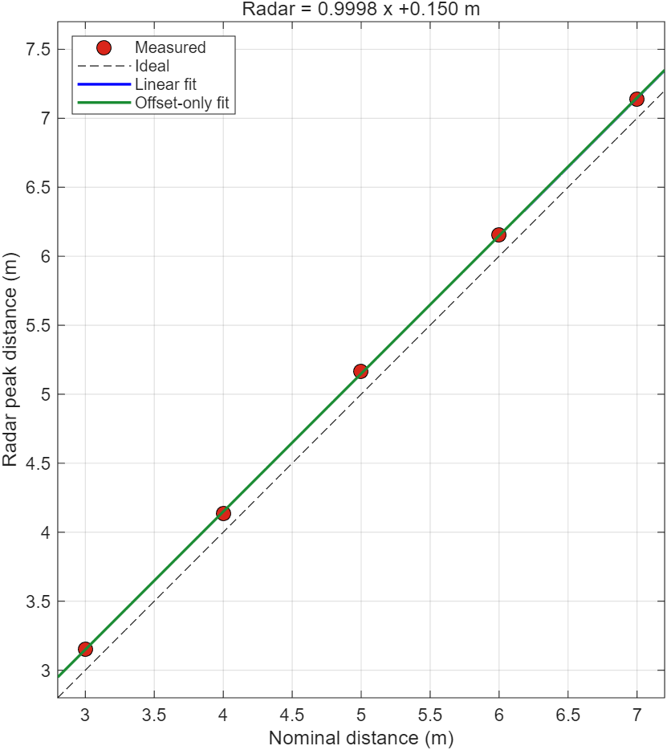
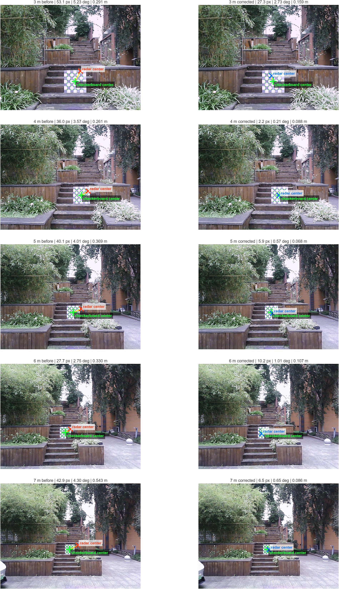

# 雷达测量补偿算法与坐标对齐分析

日期：2026-11-05  
数据来源：本地 `11-5` 室外 3/4/5/6/7 m 五组棋盘目标。原始采集数据不进入 Git 仓库。

## 1. 最终处理链

算法分成三层，不能混为一个外参矩阵：

1. **雷达原始检测**：ADC 解包、距离 FFT、多普勒 FFT、CFAR、近场 Bartlett 测角。
2. **雷达测量补偿**：修正距离、方位和俯仰的系统偏差。
3. **机械外参**：继续使用昨天的正式 `cameraToRadarR` 和 `cameraOriginInRadarM`，只负责相机坐标与雷达坐标的刚体变换。

雷达原始极坐标为 `(r, az, el)`，补偿公式为：

```text
r_corrected  = r_measured  - 0.149477 m
az_corrected = az_measured - 3.2096 deg
el_corrected = el_measured - 1.9813 deg
```

再转换成雷达直角坐标：

```text
Xr = r_corrected * cos(el_corrected) * sin(az_corrected)
Yr = r_corrected * cos(el_corrected) * cos(az_corrected)
Zr = r_corrected * sin(el_corrected)
```

相机点仍按昨天正式外参变换：

```text
p_radar = cameraToRadarR * p_camera + cameraOriginInRadarM
```

正式机械外参保持：

```text
R = [1  0  0
     0  0  1
     0 -1  0]
t = [-0.0093, -0.0063, 0.1000] m
```

## 2. 为什么不能只补俯仰角

只补偿约 `1.98 deg` 俯仰后，X 方向的方位偏差仍存在，五组总误差约为：

| 距离 | 只补俯仰后的误差 |
|---:|---:|
| 3 m | 0.19 m |
| 4 m | 0.21 m |
| 5 m | 0.32 m |
| 6 m | 0.24 m |
| 7 m | 0.47 m |

因此必须同时修正距离、方位和俯仰。补偿量应放在雷达测角输出之后，而不是写入相机机械外参。

## 3. 补偿前后结果

| 距离 | 补偿前总误差 | 三参数同组拟合后 |
|---:|---:|---:|
| 3 m | 0.315 m | 0.15 m |
| 4 m | 0.287 m | 0.02 m |
| 5 m | 0.389 m | 0.05 m |
| 6 m | 0.328 m | 0.11 m |
| 7 m | 0.547 m | 0.08 m |

距离拟合为：

```text
radar = 0.999776 * nominal + 0.150149 m
```

斜率接近 `1`，所以测距问题是固定偏差，不是比例误差。使用 `0.149477 m` 中位偏差补偿后，五组距离残差最大约 `1.5 cm`。

## 4. 留一验证

每次用四组估计方位/俯仰补偿，再验证剩余一组：

| 留出距离 | 误差 |
|---:|---:|
| 3 m | 0.16 m |
| 4 m | 0.02 m |
| 5 m | 0.06 m |
| 6 m | 0.14 m |
| 7 m | 0.12 m |

按 `0.15 m` 门限，五组中四组通过，3 m 组超出约 `1 cm`。因此配置状态为 `provisional_leave_one_out_4_of_5_pass`：可以用于继续试算和采集验证，但尚不能称为正式标定通过。

## 5. 代码中的保存位置

- 雷达补偿参数：`matlab/radar_measurement_correction.json`
- 正式机械外参：`matlab/radar_camera_extrinsics.json`
- 雷达补偿入口：`matlab/algorithm/process_final.m`
- 统一处理入口：`matlab/compute_take.m`
- 图形化文件选择入口：`matlab/run_compute_interactive.m`
- 验证明细：本目录 `radar_validation.csv`

`compute_take` 默认读取两个 JSON，并把实际参数、状态和文件路径写入结果的 `metaOut`。修改任一配置后，`compute_all` 会判定旧结果过期并重新计算。

以后在 MATLAB 中直接运行：

```matlab
cd('E:\leida\radar-camera-alignment\matlab')
run_compute_interactive
```

单组模式选择 `radar_adc.mat`，批量模式选择 `11-5` 这样的父目录。界面会在计算前询问是否应用当前补偿。

## 6. 使用边界

- 当前参数来自同一场景、同一棋盘和 3–7 m 距离，不应直接推广到更换雷达、天线板、固件或安装结构后的系统。
- RGB 使用了深度流的近似内参，角度真值仍带有相机内参误差。
- 下一轮应独立采集不参与拟合的新数据，至少覆盖近、中、远距离和左右不同位置。
- 新数据全部不超过 `0.15 m` 后，才把补偿状态从 provisional 提升为正式通过。

## 7. 结果图





## 8. 棋盘中心与雷达中心可视化

绿色十字为彩色图检测到的棋盘格中心，红色或蓝色叉为雷达目标中心经正式机械外参投影到图像后的结果。黄色线表示两个中心的像素位移。左列为补偿前，右列为距离、方位和俯仰三参数补偿后。



| 距离 | 补偿前像素误差 | 补偿后像素误差 | 补偿前三维误差 | 补偿后三维误差 |
|---:|---:|---:|---:|---:|
| 3 m | 53.1 px | 27.3 px | 0.291 m | 0.159 m |
| 4 m | 36.0 px | 2.2 px | 0.261 m | 0.088 m |
| 5 m | 40.1 px | 5.9 px | 0.369 m | 0.068 m |
| 6 m | 27.7 px | 10.2 px | 0.330 m | 0.107 m |
| 7 m | 42.9 px | 6.5 px | 0.543 m | 0.086 m |

这五组数据参与了补偿参数估计，因此本图只说明今天数据拟合集上的改善。3 m 组补偿后仍为 `0.159 m`，略高于 `0.15 m` 门限，不能据此将实验补偿合并到正式主分支。

像素误差只作诊断，因为 RGB 投影使用 `meta.json` 记录的深度流近似内参，并非独立标定的 RGB 内参。米制误差使用棋盘中心方向、标称卷尺距离和正式机械外参计算。

复现五组图：

```matlab
cd('<repo>\matlab')
addpath tools
visualize_center_alignment('E:\leida\11-5')
```
