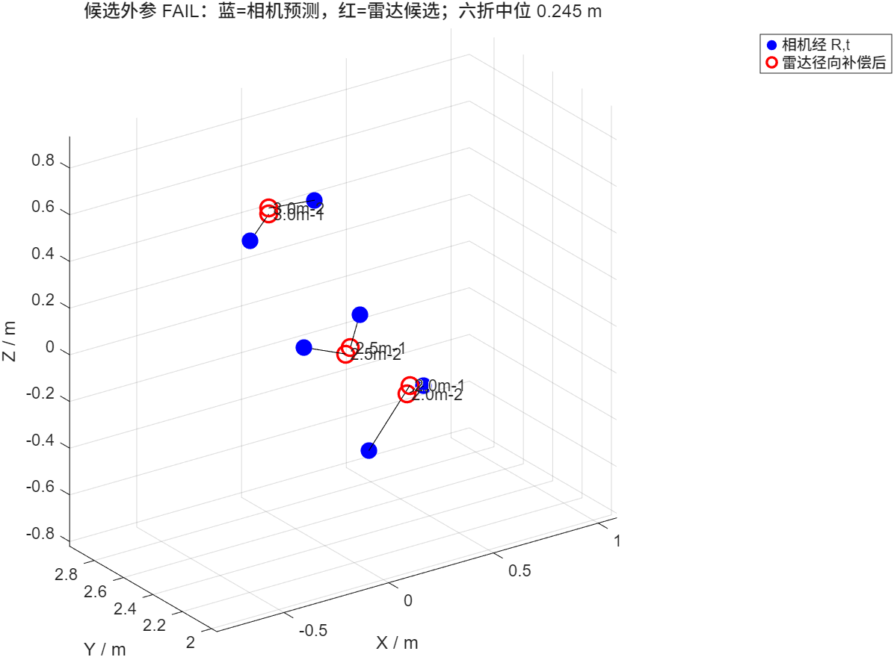
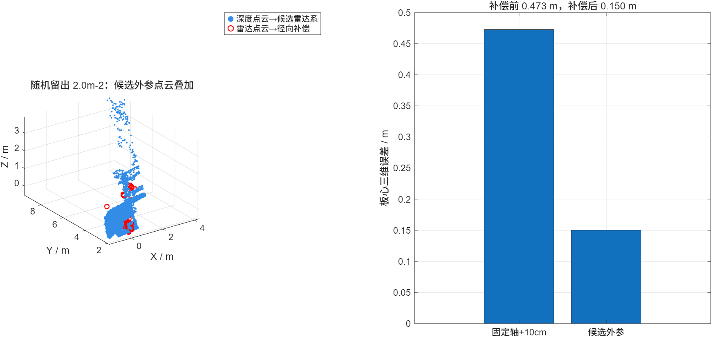

# 雷达与深度相机外参标定结果及坐标投影说明

生成日期：2026-11-05  
数据范围：`3.2/results/takes/*_res.mat` 中六组有铁板点云及对应无板点云

## 1 当前结论

当前正式外参保持不变。点云拟合得到的角度补偿候选虽然把六折中位误差从 `0.421 m` 降到了 `0.245 m`，改善 `41.8%`，但仍高于 `0.150 m` 的验收门限。因此：

- 正式外参：继续使用。
- 候选外参：状态为 `FAIL`，`applicable=false`，不能直接交给 `compute_take`。
- 当前实际使用的平移为 `t=[-0.0093, -0.0063, 0.1000] m`。
- 点云拟合候选平移为 `t=[-0.020683, -0.016942, 0.094972] m`，只能作为诊断结果。

这里的 `t` 表示**相机坐标原点在雷达坐标系中的位置**，不是雷达到标定板的距离，也不是板心坐标。

## 2 坐标系定义

| 坐标系 | X 轴 | Y 轴 | Z 轴 |
|---|---|---|---|
| 深度相机 OpenNI | 向右 | 向下 | 向前 |
| 雷达 | 向右 | 向前 | 向上 |

所有坐标和距离单位均为米。

## 3 当前正式外参

相机坐标到雷达坐标的旋转矩阵和位移为：

```text
R = [ 1   0   0
      0   0   1
      0  -1   0 ]

t = [-0.0093, -0.0063, 0.1000] m
```

物理含义：相机原点大约位于雷达原点左侧 `9.3 mm`、后方 `6.3 mm`、上方 `100.0 mm`。

相机点 `p_camera=[Xc,Yc,Zc]^T` 投影到雷达坐标的统一公式为：

```text
p_radar = R * p_camera + t
```

使用当前正式外参时，分量形式为：

```text
Xr =  Xc - 0.0093
Yr =  Zc - 0.0063
Zr = -Yc + 0.1000
```

## 4 点云拟合候选外参

候选参数为：

```text
R_candidate = [ 0.969453   0.244666   0.017312
               -0.070646   0.210940   0.974943
                0.234883  -0.946384   0.221781 ]

t_candidate = [-0.020683, -0.016942, 0.094972] m

roll  =  13.189 deg
pitch = -13.585 deg
yaw   =  -4.168 deg

radarRangeBiasM = 0.119997 m
```

角度补偿定义为：

```text
R = Rz(yaw) * Ry(pitch) * Rx(roll) * R0
```

候选结果没有通过验收，主要原因如下：

- 六折中位误差为 `0.245 m`，高于 `0.150 m` 门限。
- `pitch` 的 bootstrap 区间接近全部允许范围，角度约束较弱。
- 相机板心 X 坐标覆盖约 `-0.245 m` 到 `0.185 m`，但雷达候选没有可靠跟随标定板的左右移动。
- 继续放宽刚体拟合会把雷达测角误差解释成三脚架倾角。

因此不能把上述候选参数写入正式外参。

## 5 从深度像素得到相机三维坐标

对于深度图像素 `(u,v)`，先将深度原始值 `D(u,v)` 换算为米：

```text
Zc = D(u,v) * depthScale
Xc = (u - cx) * Zc / fx
Yc = (v - cy) * Zc / fy
```

项目默认内参为：

```text
fx = 570.3422
fy = 570.3422
cx = 319.5
cy = 239.5
```

实际处理时，程序会优先读取采集目录 `meta.json` 中记录的内参和 `depthScale`。

## 6 MATLAB 中将相机点投影到雷达坐标

假设 `cameraPoints` 为 `N x 3` 相机坐标点，单位为米：

```matlab
extrinsicsFile = fullfile('E:\leida\3.2\matlab', ...
    'radar_camera_extrinsics.json');
E = load_radar_camera_extrinsics(extrinsicsFile);

cameraPoints = double(cameraPoints);              % N x 3
radarPoints = (E.cameraToRadarR * cameraPoints.').';
radarPoints = radarPoints + E.cameraOriginInRadarM;
```

从雷达坐标反变换回相机坐标：

```matlab
cameraPoints = (E.cameraToRadarR.' * ...
    (radarPoints - E.cameraOriginInRadarM).').';
```

`compute_take` 内部执行的也是同一个变换：

```matlab
radarPoints = (R * cameraPoints.').';
radarPoints = radarPoints + t;
```

## 7 雷达径向偏差补偿

径向偏差只用于修正雷达测得的点 `q`，不能再次作用到相机点上：

```text
q_corrected = q * (norm(q) - b) / norm(q)
```

候选结果的 `b=0.119997 m`。在处理链中等价于：

```matlab
rangeOffsetM = -radarRangeBiasM;
```

当前正式外参没有该字段时，程序按 `radarRangeBiasM=0` 处理，所以默认不会进行径向补偿。

## 8 一组实际坐标计算

随机取 `2.5m-1` 组检测到的相机板心：

```text
p_camera = [0.053279, 0.591813, 2.431000] m
```

使用当前正式外参：

```text
p_radar_formal = [0.043979, 2.424700, -0.491813] m
```

计算过程为：

```text
Xr =  0.053279 - 0.0093   =  0.043979 m
Yr =  2.431000 - 0.0063   =  2.424700 m
Zr = -0.591813 + 0.1000   = -0.491813 m
```

使用未通过验收的候选外参：

```text
p_radar_candidate = [0.217850, 2.474217, 0.086553] m
```

两种外参得到的 Z 坐标相差约 `0.578 m`，远大于相机和雷达约 `0.10 m` 的安装高度。这说明候选旋转中仍混有雷达测角误差，不能直接应用。

## 9 六组板心结果

| 数据组 | 相机板心 X | 相机板心 Y | 相机板心 Z | 雷达候选编号 | 样本内残差 |
|---|---:|---:|---:|---:|---:|
| 2.5m-1 | 0.0533 | 0.5918 | 2.4310 | 1 | 0.137 m |
| 2.5m-2 | -0.2195 | 0.5987 | 2.4140 | 1 | 0.211 m |
| 2.0m-1 | -0.2455 | 0.7874 | 1.9360 | 1 | 0.322 m |
| 2.0m-2 | 0.0289 | 0.5994 | 1.9360 | 1 | 0.106 m |
| 3.0m-1 | -0.1197 | 0.4631 | 2.9310 | 2 | 0.133 m |
| 3.0m-2 | 0.1852 | 0.4190 | 2.9310 | 2 | 0.190 m |

上表是六组共同拟合后的样本内残差，不等同于六折留一验证误差。

## 10 验证图

六组相机预测板心和雷达候选板心：



固定随机种子选中的 `2.0m-2` 留出验证：



该留出组的板心误差从 `0.473 m` 降到了 `0.150 m`，但单组结果不能代替六折统计。六折中位误差仍为 `0.245 m`，因此最终状态为 `FAIL`。

## 11 compute_take 使用方法

继续使用正式外参：

```matlab
takeDir = 'E:\leida\11-4\你的采集目录';
[resFile, summary] = compute_take(takeDir);
```

程序默认读取：

```text
E:\leida\3.2\matlab\radar_camera_extrinsics.json
```

显式指定候选文件的接口为：

```matlab
candidatePath = fullfile('E:\leida\3.2\results', ...
    'extrinsics_calibration', ...
    'radar_camera_extrinsics_candidate.json');

opts = struct('extrinsicsFile', candidatePath);
[resFile, summary] = compute_take(takeDir, opts);
```

当前候选文件的 `applicable=false`，因此上述调用会立即报错。这是保护机制，防止把未通过验收的角度写入新点云。

## 12 后续建议

当前主要问题是雷达点云的横向板心信息，而不是坐标投影公式。下一步应检查 `angle_nf_bartlett.m` 的方位角估计，或从原始 64 通道数据做有板减无板的差分波束形成。只有雷达候选能稳定跟随标定板左右移动后，才适合重新求解三脚架角度。

重新标定后的最低应用条件仍应是：

- 至少五组检测有效；
- 六折板心误差中位数不超过 `0.150 m`；
- 候选不贴角度和平移边界；
- 候选 JSON 状态为 `PASS` 且 `applicable=true`。

