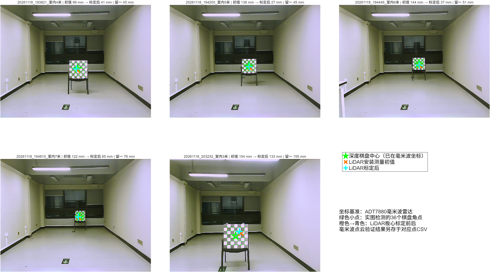

# MID-70 原始数据、点云生成与雷达中心对齐

项目沿用既有坐标设计：**ADT7880 毫米波雷达坐标系是统一坐标系**。深度相机通过现有 `camera -> radar` 外参进入雷达坐标，MID-70 通过新增 `lidar -> radar` 外参进入雷达坐标。

```text
深度相机点 ── cameraToRadar ──┐
                              ├── ADT7880 雷达坐标：X右 / Y前 / Z上
MID-70 点 ─── lidarToRadar ───┘
```

## 1. 采集产物

新采集使用 `LIVOXBIN_V3`：保存 Livox-SDK `LivoxRawPoint` 的 `XYZ int32 mm + reflectivity uint8`，并保留每个 SDK 数据包的设备时间戳、时间类型、主机 QPC、统一 `t_rel_ms` 和该包对应的点范围。它是 SDK 解出的无损原始笛卡尔记录，不是网卡层 UDP 抓包。

V1/V2 浮点点云文件仍可回放和离线读取。每个 take 同时保存：

- `lidar/*.bin`：原始 LiDAR 记录；
- `lidar_frames.csv`：批次时间范围、包数、点数；
- `manifest.csv`：与雷达/相机共用的主机时间轴；
- `meta.json`：设备、坐标、格式和丢批统计。

## 2. 原始数据生成点云

采集程序可直接导出：

```powershell
cd E:\leida\radar-camera-alignment\capture\app
.\build.ps1
.\export-lidar.ps1 -TakeDirectory "完整take目录" -Merged
```

输出到 `take/lidar_cloud`：每批一个带反射率的二进制 PLY、`index.csv`，加 `--merged` 后还有 `merged.ply`。合并点云未做运动补偿，静态标定适用，移动平台必须先做逐包位姿补偿。

MATLAB 批量导出：

```matlab
cd('E:\leida\radar-camera-alignment\matlab')
addpath('lidar')
summary = export_livox_take(takeDir);
```

MATLAB 额外输出 `lidar_cloud.mat`，保留每批点和反射率。

## 2.1 采集后立即验收

MID-70 与 Astra 深度相机的处理方式不同：Astra 点云由深度图和相机内参反投影生成；MID-70 的 `LIVOXBIN_V3` 已经保存设备 SDK 输出的原生笛卡尔 `XYZ int32 mm + reflectivity`。因此不要把 `lidar/*.bin` 套用深度相机的针孔模型。

采完后在 MATLAB 中运行：

```matlab
cd E:\leida\radar-camera-alignment\matlab
addpath('lidar')
takeDir = 'E:\leida\radar-camera-alignment\capture\takes\你的采集目录';
report = inspect_lidar_radar_take(takeDir);
```

默认快速验收会检查：LiDAR 文件和时间轴数量、LIVOXBIN 版本、XYZ 有效性、反射率、点云范围、毫米波丢包、两路最近帧时间差，并绘制 MID-70 原生坐标点云和时间差分布。长时间采集只抽样读取点云批次，但时间轴检查覆盖全部批次。

需要同时运行现有毫米波 FFT/CFAR/测角链并并排查看时：

```matlab
report = inspect_lidar_radar_take(takeDir, struct( ...
    'processRadar', true, ...
    'maxRadarFrames', 12));
```

毫米波点云是由 `radar_adc.mat` 处理得到，MID-70 点云是设备原生 XYZ。`lidar -> radar` 外参通过质检前，两者只能并排比较目标距离、形状和时间一致性，不能直接叠加后判断空间误差。

## 3. LiDAR 与雷达时间配对

```matlab
pairs = pair_lidar_radar_frames(takeDir, 30);
```

LiDAR 使用批次起止时间中点，毫米波使用物理帧首末包时间中点，按统一主机时钟做最近邻。静态标定板可采用此方式；运动场景必须先完成 MID-70 PTP/PPS 与雷达时间映射验收。

## 4. LiDAR 到雷达外参框架

1. 固定 MID-70、ADT7880 和相机，标定期间不能改变安装关系。
2. 使用两种传感器都能稳定检测的高反射平面或角反射器；每个姿态静止采集。
3. 至少采 8–12 个姿态，覆盖左/右、上/下、近/远，不能只沿正前方直线移动。
4. 从 LiDAR 点云分割目标并求三维中心；从毫米波处理结果选择同一目标中心。
5. 将中心填入 `matlab/lidar/lidar_radar_correspondences.csv`，至少留 2–3 组 `holdout`。

```matlab
report = run_lidar_radar_calibration;
```

候选写入 `lidar_radar_extrinsics_candidate.json`，公式为：

```text
p_radar = lidarToRadarR * p_lidar + lidarOriginInRadarM
```

求解器包含鲁棒权重、姿态覆盖检查以及拟合/留出误差。默认留出误差门限为中位数 8 cm、P95 15 cm；这是框架初始门限，应按真机目标尺寸和雷达角分辨率重新定标。

## 5. 三路统一到雷达坐标

```matlab
lidarExt = fullfile('lidar','lidar_radar_extrinsics_candidate.json');
cameraExt = 'radar_camera_extrinsics.json';
out = transform_multimodal_to_radar(lidarPoints, cameraPoints, lidarExt, cameraExt);
```

- `out.lidarRadar`：MID-70 点在 ADT7880 雷达坐标系中的位置；
- `out.cameraRadar`：深度相机点在同一雷达坐标系中的位置。

只有候选 JSON 的 `applicable=true`，并通过独立姿态与整幅点云叠加检查后，才可提升为正式外参。当前仓库没有 MID-70 真机标定数据，所以没有生成正式数值。

## 6. 同批三路点云可视化

完成雷达/相机处理并得到 LiDAR→雷达外参后：

```matlab
cd('E:\leida\radar-camera-alignment\matlab')
addpath('lidar')

takeDir = '完整take目录';
lidarExt = fullfile('lidar', 'lidar_radar_extrinsics_candidate.json');

result = visualize_multimodal_frame(takeDir, lidarExt, struct( ...
    'frameIndex', 1, ...
    'maxDeltaMs', 30));
```

函数在缺少处理结果时自动调用 `compute_take`，然后按雷达物理帧时间选择最近的 MID-70 批次。窗口包含：毫米波点云、MID-70 点云、深度相机点云、三路雷达坐标叠加。

指定雷达帧或保存图片：

```matlab
result = visualize_multimodal_frame(takeDir, lidarExt, struct( ...
    'radarFrame', 12, ...
    'savePath', fullfile(takeDir, 'multimodal_frame12.png')));
```

播放器中也可以按帧查看四个点云画面：

```matlab
view_take(resFile, ...
    'lidarWindowMs', 1000, ...
    'lidarExtrinsicsFile', lidarExt)
```

带 LiDAR 的窗口固定为深度、原生 MID-70、毫米波和三路 ADT7880 融合四格；RGB 当前帧在独立图片窗口中与帧号同步，不播放视频。外参路径可显式提供；JSON 中 `applicable=true` 才启用融合，否则前三格仍可使用，融合格只显示提示。仓库归档的候选外参位于 `docs/extrinsics/lidar-radar/lidar_radar_extrinsics_candidate.json`。

返回值保留三路完整点云和时间差：`result.radarPoints`、`result.lidarRadar`、`result.cameraRadar`、`result.lidarRadarDtMs`、`result.cameraRadarDtMs`。图上抽样只为提高交互速度，不会修改返回的完整数据。

## 7. 2026-11-18 五组棋盘中心标定

相机安装关系未改变，继续沿用正式 `camera -> radar` 外参。五组 3/4/5/6/7 m 静态数据使用彩色棋盘角点限定深度 ROI，深度板心已经位于 ADT7880 坐标；MID-70 使用同一时刻 1000 ms 累计点云提取棋盘平面中心。

由于五组目标主要沿正前方变化，求解采用与实际安装一致的受约束模型：固定轴向转换 `X_lidar -> Y_radar`、`Y_lidar -> -X_radar`、`Z_lidar -> Z_radar`，仅拟合三轴平移，防止不可观测旋转漂移。运行：

```matlab
cd('E:\leida\radar-camera-alignment\matlab')
addpath('lidar')
report = calibrate_lidar_radar_checkerboards;
```

LiDAR 棋盘中心不再由固定主距离 `±12 mm` 薄片直接求取。算法先在相机棋盘 ROI 和安装初值约束的候选区域内调用 `pcfitplane`，要求平面法向位于雷达前向 `±20°`，再用 SVD 和 MAD 迭代精修内点。内点投影到由雷达 X/Z 方向构造的平面坐标后，使用 `3%–97%` 分位边界的中点恢复完整倾斜棋盘的几何中心；深度棋盘的宽高同时限制平面区域，避免椅背或墙面被并入。测得的板面倾角只用于板心补偿和诊断，不参与 LiDAR 安装旋转估计。

本次候选平移为 `[-0.1361, -0.1024, +0.0547] m`，固定轴向转换不变，旋转修正为 `0°`。五组板面倾角为 `4.33°–10.18°`，P95 平面厚度约 `6.8–10.2 mm`。倾斜补偿将拟合误差中位数从 `97.6 mm` 降至 `41.5 mm`，留一验证中位数从 `112.5 mm` 降至 `51.2 mm`；因此候选保持 `applicable=true`。3 m 组仍是误差最大的样本（约 `132.9 mm`），提升正式外参前仍应结合独立姿态验证。

结果图、候选 JSON 和对应关系 CSV 已归档到 `docs/extrinsics/lidar-radar/`：`lidar-radar-alignment-20261118.png` 是昨晚五组数据的雷达坐标投影总图，`checkerboard_centers_before_after.png` 显示实景标定前后中心，`tilt_compensation_before_after.png` 对比旧薄片中心与倾斜平面补偿中心，`lidar_radar_correspondences.csv` 保存每组平面法向、倾角、厚度、内点数和中心补偿量。原始 `results/` 目录仍被 Git 忽略，脚本不会覆盖正式外参。



## 8. 更改安装位置后的自动标定

LiDAR 或相机相对毫米波雷达的位置改变后，先编辑 `matlab/lidar/lidar_radar_calibration_config.m`。所有位置统一填写为 ADT7880 坐标中的 `[右, 前, 上]`，单位为米。例如 LiDAR 位于雷达正下方 15 cm：

```matlab
config.lidarOriginInRadarM = [0 0 -0.15];
```

更方便的方式是在采集程序中点击“安装位置…”。程序保存到 `capture/app/calibration_installation.json`，MATLAB 配置模板会自动读取该文件；每个新 take 的 `meta.json` 也会保存一份当时的安装快照。

选择采集组并运行：

```matlab
cd('E:\leida\radar-camera-alignment\matlab')
addpath('lidar')
config = lidar_radar_calibration_config();
config.takeNames = ["第一组目录名"; "第二组目录名"; "第三组目录名"];
report = run_lidar_radar_auto_calibration(config);
```

建议使用至少五组静止棋盘数据。仅沿正前方采集时保持 `solveMode='translation_only'`，程序固定 LiDAR 与毫米波方向关系，只拟合 XYZ 平移。如果要估计旋转，必须补充明显的左/右、上/下和远/近姿态，再显式改为 `rigid`。

相机没有移动时，`cameraOriginInRadarM=[]`，程序沿用正式相机外参。相机只发生平移时，可填写新的相机光心 `[右, 前, 上]`；程序会把已有处理结果先还原到相机坐标，再应用新平移。若相机朝向也改变，三个距离无法确定旋转，必须先重新标定相机旋转并填写 `cameraToRadarR`。

缺少 `_res.mat` 时默认自动调用 `compute_take`。每次运行使用带时间戳的新结果目录，生成候选 JSON、CSV、标定前后实景图和误差图，不覆盖正式外参。

批处理也支持串联计算与标定：`compute_all([], struct('autoCalibrate', true))` 会先按共享安装配置计算所有 take，再调用 `run_lidar_radar_auto_calibration`。随后直接运行 `view_take`，它会自动选择 `results/lidar_radar_calibration_*` 中最新的 `applicable=true` 候选；若本次标定失败，则继续使用最近一次有效候选。
